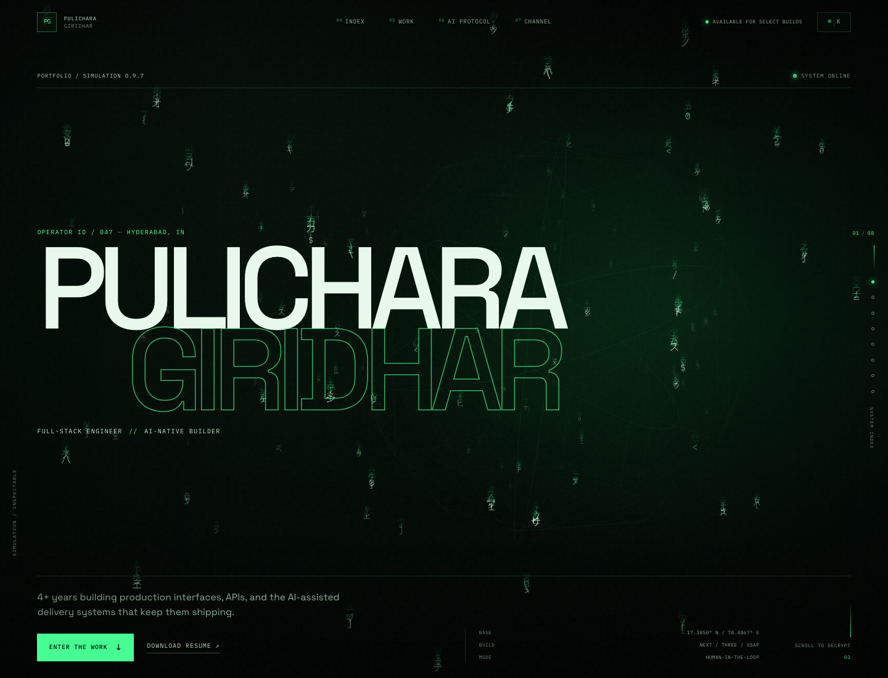

# Matrixfolio

A Matrix / simulation-theory portfolio for **Pulichara Giridhar** — built as an inspectable system rather than a static resume. The site combines a live WebGL glyph field, scroll-driven narrative, a command shell, and a record of AI-assisted engineering practice.

**Live:** <https://matrixfolio.vercel.app>



## What it does

- **Live WebGL canvas** — a custom Three.js + GLSL glyph field rendered in a single draw call
- **Scroll-driven cinema** — GSAP ScrollTrigger + Lenis use scroll position as the playhead
- **Eight narrative beats** — boot, hero, red-pill/blue-pill choice, manifesto, construct, bullet time, work, AI protocol, and exit
- **Command shell** — `⌘K` / `Ctrl+K` terminal with navigation, resume, and section commands
- **Accessible by default** — keyboard navigation, reduced-motion path, no-JS fallback, and a WCAG 2.1 A/AA axe audit
- **Responsive** — desktop, tablet, and mobile layouts

## Stack

| Layer | Choice |
| --- | --- |
| App | Next.js 16, React 19, TypeScript |
| 3D | Three.js + custom GLSL |
| Scroll | GSAP + ScrollTrigger + Lenis |
| UI motion | Motion |
| Styling | Hand-authored CSS + Tailwind v4 reset |
| Content | Typed local content model |

## Run it

```bash
npm install
npm run dev        # http://localhost:3000
npm run check      # TypeScript
npm run build      # production build
npm run start      # serve the production build
```

The production build uses `next build --webpack`. The current Next 16 + Turbopack combination panics during static generation, while the webpack path is stable.

## Structure

```text
src/
  app/                    route, metadata, global CSS, OG/Twitter images
  components/
    experience.tsx        root composition + GSAP/Lenis orchestration
    simulation-canvas.tsx dynamic Three.js + GLSL glyph field
    boot-sequence.tsx     skippable intro
    command-shell.tsx     ⌘K terminal
    sections/             hero, choice, manifesto, construct, work, protocol, channel, exit
  lib/
    content.ts            typed portfolio content
    simulation-state.ts   shared animation state
docs/
  research/               portfolio and scroll-motion teardowns
  screenshots/            README image
```

## Notes

- The site is designed to be statically rendered and deployed to Vercel.
- Project metrics and work content live in `src/lib/content.ts`.
- The resume PDF is served from `public/giridhar-resume.pdf`.
- This repository intentionally excludes private interview-prep notes and the duplicate root resume PDF.

## Status

`v0.9.7` — the eight-beat experience, command shell, responsive layouts, reduced-motion path, and accessibility pass are implemented. Remaining work: production domain, real case-study pages, and optional generated project stills.
